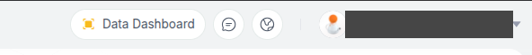
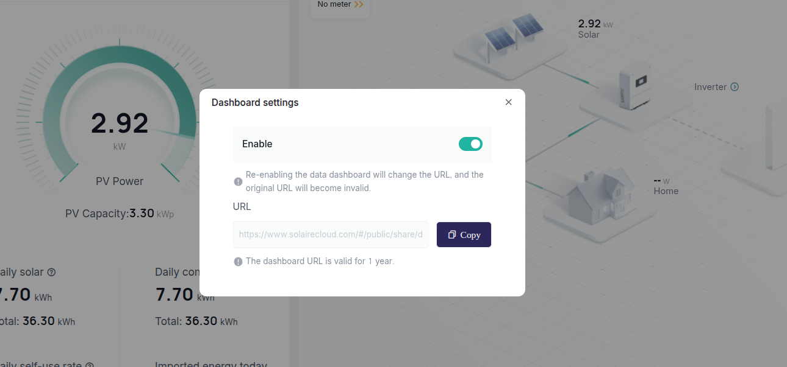

# Solaire Cloud for Home Assistant

[](https://github.com/abruu/ha-solaire-cloud/actions/workflows/validate.yaml)

A HACS custom integration that reads the **public share page** of a [Solaire Cloud](https://www.solairecloud.com)
solar site and gives Home Assistant sensors that work in the **Energy dashboard**. Solaire has no official API for
this, so the integration talks to the same endpoint the share page uses and can break whenever Solaire changes it.

> **Unofficial.** Not affiliated with or endorsed by Solaire. Use it only with a share link you were given for your own
> system, keep the polling interval gentle, and use it at your own risk. The share page's encryption key is **not**
> included here; you enter it yourself during setup (see below).

## Install

1. In HACS, open the menu (three dots), **Custom repositories**, add `https://github.com/abruu/ha-solaire-cloud`
   with category **Integration**, then download **Solaire Cloud** and restart Home Assistant.
2. **Settings, Devices & services, Add integration, Solaire Cloud**.
3. Paste your share link, the AES key and the AES IV.
4. In **Settings, Dashboards, Energy**, choose **Solaire Cloud Energy total** as the solar production source.

### Getting your share link

In the Solaire Cloud web portal, click **Data Dashboard** (top right), switch **Enable** on, and press **Copy**.
The link is valid for one year; re-enabling it creates a new link and the old one stops working.





### Getting the AES key and IV

The share page encrypts its requests with AES-128-CBC, using a key and IV that are hard-coded in its own JavaScript:

1. Open your share link in a desktop browser, open the developer tools and go to **Sources** (or **Network**, then open
   the main `assets/index-*.js` file).
2. Search it for `CBC` or `AES.encrypt`. Next to it are two 16-character strings: the key and the IV.

The integration stores them in the config entry (redacted in diagnostics). They are never logged.

## Sensors

| Sensor | Unit | Notes |
|---|---|---|
| PV power | W | live; the 5-minute power and clear-sky curves are attributes (not recorded) |
| Energy today / this month / this year / total | kWh | `total_increasing`; use **Energy total** for the Energy dashboard |
| Load energy today, Grid import today, Grid export today | kWh | as reported by the site (often 0 without a meter) |
| Self-use today | % | |
| Peak power today, Peak time, First light, Last light | W / time | from today's curve |
| Energy yesterday / last 7 days, Best day, Average day, Month projection | kWh | |
| Production hours today, Equivalent full-sun hours | h | |
| Inverter stops today, Stopped time today, Energy lost to stops today | count / min / kWh | zero readings in the middle of the day, for example from grid over-voltage cut-offs |
| Clear-sky energy today | kWh | ideal output for your location, assuming a 10 degree south tilt |
| Installed capacity | kW | diagnostic |

A few extra sensors (morning/midday/afternoon energy, monthly load and grid, self-sufficiency) are disabled by default.
Only PV-side data exists: no battery, no live house load, no live grid power.

## Expired share link

Share links expire (usually yearly). When Solaire keeps rejecting the request, Home Assistant raises a **repair /
re-authentication** prompt: paste the new link there. The key and IV stay as they are. **Reconfigure** on the
integration page changes the link, key and IV; **Configure** sets the polling interval (default 60 s, 30 to 600 s).

After a failed request the integration waits 1, 2, 4, 8 and then 10 minutes before trying again.

## Notes

- Tested with Home Assistant 2026.10; `hacs.json` sets that as the minimum version. The integration uses the
  `cryptography` package that Home Assistant already ships.
- Setting up a share link that is already configured is refused.
- The older script-and-package setup is kept in [`manual/`](manual/README.md).

## Protocol notes

- `POST https://www.solairecloud.com/mesh/web/v1/public/share/display/houseHold/screen/getUserOverview?data=<enc>`
- Plain headers: `shareCode`, `sharePageCode: 1000`, `crytoVer: 1`.
- The query `data` is AES(`timeStamp=<ms>&requestId=<uuid>`), the body is `{"data": AES(json)}` with
  `{"curDate","year","month","day"}`, and the response is `{"data": AES(json)}`. AES-128-CBC, PKCS7, base64.
- The response has `statisticsInfo`, `powerCurve.acPower` (288 five-minute slots, null = no report) and `energyList`
  (daily kWh for the month). Changing `curDate` returns past days.

## Development

```
uv venv --python 3.14 && uv pip install pytest-homeassistant-custom-component
uv run --no-project pytest tests
```

## License

MIT, see `LICENSE`.
